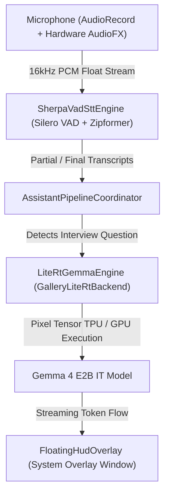

# AI Interview Assistant 🎙️⚡

An on-device, real-time **AI Interview Copilot** for Android powered by **Sherpa-ONNX Zipformer STT**, **Silero VAD**, and **Google LiteRT-LM Gemma 4 E2B IT** with hardware acceleration for **Google Pixel Tensor TPU/NPU** and **OpenCL/Vulkan GPU**.

---

## 🌟 Key Features

- **🎙️ Real-Time Speech Recognition (STT & VAD):**
  - Continuous 16 kHz MONO audio recording using Android's `AudioRecord` with hardware-level `NoiseSuppressor`, `AutomaticGainControl`, and `AcousticEchoCanceler`.
  - **Sherpa-ONNX Zipformer STT Engine** and **Silero VAD** processing 32ms audio frames in real time with automatic speech endpointing.
  - **Universal Contextual Biasing (Hotwords):** Dynamic 70+ term dictionary covering software engineering, system design, business, finance, medicine, and university admissions.

- **⚡ Google LiteRT-LM Gemma 4 Candidate Copilot:**
  - **Pixel Tensor TPU/NPU Acceleration:** Direct southbound delegation to `Backend.NPU(nativeLibraryDir = context.applicationInfo.nativeLibraryDir)` for AOT EdgeTPU models (`gemma-4-E2B-it_Google_Tensor_G5.litertlm`).
  - **Universal GPU Acceleration:** `Backend.GPU()` OpenCL/Vulkan delegate for standard Gemma models (`gemma-4-E2B-it.litertlm`).
  - **Thread-Safe JNI Dispatcher:** Serializes all native C++ `Engine` and `Conversation` operations on a dedicated `LiteRT-GPU-Thread` single-threaded executor, preventing native stack corruption.
  - **Fail-Safe Fallback:** Automatically switches to the standard GPU model if TPU allocation is restricted on a given system build.

- **🖥️ Floating System Overlay HUD:**
  - Compact, draggable floating overlay (`TYPE_APPLICATION_OVERLAY`) accessible over any app.
  - **Live Transcript Stream:** Displays real-time spoken text and highlights auto-detected interview questions.
  - **Quick-Action Category Chips:** One-tap category switching (*General*, *System Design*, *Algorithms*, *Behavioral STAR*, *QA / Code Review*) adapting prompt style and domain context on the fly.
  - **Response Panel & Controls:** Streaming LLM candidate answers with live Time-To-First-Token (TTFT) metrics, *Answer Now* force trigger, *Pause/Resume*, and *Clear*.

---

## 🏗️ Architecture Overview



---

## 📁 Repository Structure

```
AIInterviewAssistant/
├── app/
│   ├── src/main/java/com/local/interviewassistant/
│   │   ├── core/
│   │   │   ├── di/AppContainer.kt             # Dependency Injection Container
│   │   │   └── model/                         # Domain Models, Configs & States
│   │   │       ├── AppConfig.kt               # Model Paths, URLs, Hotword Gen, Prompt Formatting
│   │   │       ├── AssistantState.kt          # Assistant Pipeline State Machine
│   │   │       ├── CopilotUiState.kt          # Overlay UI State & Category Enums
│   │   │       ├── LlmGenerationConfig.kt     # Hyperparameters & Prompt Styles
│   │   │       └── TranscriptSegment.kt       # Smart Question Detection Heuristics
│   │   ├── data/
│   │   │   ├── audio/AudioCaptureSource.kt    # AudioRecord Stream & Hardware Filters
│   │   │   ├── llm/                           # LiteRT-LM & MediaPipe Engines
│   │   │   │   ├── GalleryLiteRtBackend.kt    # LiteRT-LM Native Engine & NPU/GPU Delegation
│   │   │   │   ├── LiteRtGemmaEngine.kt       # Thread-Safe JNI Flow Generator
│   │   │   │   └── LlmInferenceBackend.kt     # Backend Abstractions
│   │   │   ├── provisioning/                  # Model Provisioning & Downloads
│   │   │   └── stt/                           # Speech-To-Text & VAD Engines
│   │   │       ├── SherpaOnnxRuntimeBackend.kt# Sherpa-ONNX Native JNI Recognizer
│   │   │       └── SherpaVadSttEngine.kt      # VAD Framing & Utterance Endpointing
│   │   ├── service/
│   │   │   ├── AssistantForegroundService.kt  # Android Foreground Service
│   │   │   ├── AssistantPipelineCoordinator.kt# Audio-STT-LLM Pipeline State Machine
│   │   │   └── OverlayLifecycleOwner.kt       # Custom Lifecycle Owner for Overlay Views
│   │   └── ui/
│   │       ├── main/
│   │       │   ├── DashboardScreen.kt         # Model Provisioning & Dashboard Control UI
│   │       │   └── MainActivity.kt            # Entry Activity & Permission Handlers
│   │       └── overlay/
│   │           └── FloatingHudOverlay.kt      # Floating Compose Overlay HUD
```

---

## 🛠️ Getting Started & Build Instructions

### Prerequisites
- Android Studio 2024.2.1 (Ladybug / Jellyfish or newer)
- Android SDK 35 / 37 (Minimum SDK 34 for Android 14/15)
- Physical Android Device (Recommended: Google Pixel 8, 9, or 10 Pro XL for Tensor TPU acceleration)

### Build Commands
```bash
# Clone the repository
git clone https://github.com/eduardoben/ai-interview.git
cd ai-interview

# Run unit test suite (29 tests)
./gradlew testDebugUnitTest

# Assemble Debug APK
./gradlew assembleDebug
```

---

## ⚙️ Hardware & Model Provisioning Guide

1. **Launch the App:** Open **AI Interview Assistant** and grant Microphone, Notification, and System Overlay permissions on the dashboard.
2. **Download Speech Models:** Tap **Auto-Download Speech Models (VAD + STT)** to download Silero VAD and Zipformer STT models.
3. **Download LLM Model:**
   - **Pixel Tensor TPU Devices (Pixel 8, 9, 10 Pro XL):** Tap **Pixel TPU Variant** to download `gemma-4-E2B-it_Google_Tensor_G5.litertlm`.
   - **All Other Android Devices:** Tap **GPU Variant** to download `gemma-4-E2B-it.litertlm`.
4. **Start Assistant:** Tap **Start Interview Assistant** and switch to your target interview application!

---

## 📄 License
This project is released under the **MIT License**.
