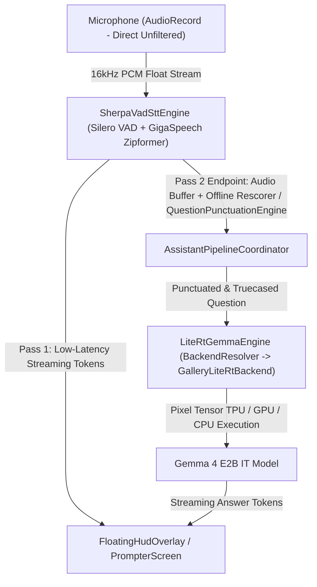

# AI Interview Assistant 🎙️⚡

An on-device, real-time **AI Interview Copilot** for Android powered by **Sherpa-ONNX Zipformer STT**, **Silero VAD**, and **Google LiteRT-LM Gemma 4 E2B IT** with hardware acceleration for **Google Pixel Tensor TPU/NPU** and **OpenCL/Vulkan GPU**.

---

## 🌟 Key Features

- **🎙️ Real-Time Speech Recognition (STT & VAD):**
  - High-fidelity 16 kHz MONO audio capture via Android `AudioRecord` with hardware noise suppression / AGC bypass to preserve 3 kHz – 8 kHz unvoiced consonant acoustics (fricatives / plosives).
  - **Conversational Multi-Corpus Zipformer STT:** Powered by Sherpa-ONNX streaming Zipformer trained on **GigaSpeech + LibriSpeech** (10,000+ hours of conversational interviews, talks, and podcasts; 187.8 MB model) and **Silero VAD** processing 32ms frames.
  - **Transducer Context Gating & Lookahead Flushing:** 250ms pre-roll rolling buffer prevents ambient room noise from corrupting neural recurrent memory; trailing lookahead frames are flushed via `stream.inputFinished()` on endpointing to eliminate clipped sentence endings.
  - **Universal Contextual Biasing (Hotwords):** Subword BPE FST trie matching 70+ technical, behavioral, business, and domain terms using `modified_beam_search` (`maxActivePaths = 4`, `blankPenalty = 1.0f`, `hotwordsScore = 2.0f`).

- **⚡ Google LiteRT-LM Gemma 4 Candidate Copilot:**
  - **Pixel Tensor TPU/NPU Acceleration:** Direct southbound delegation to `Backend.NPU(nativeLibraryDir = context.applicationInfo.nativeLibraryDir)` for AOT EdgeTPU models (`gemma-4-E2B-it_Google_Tensor_G5.litertlm`). Bundles the native `libLiteRtDispatch_GoogleTensor.so` dispatch shim in `app/src/main/jniLibs/arm64-v8a/` to interface with the Pixel EdgeTPU HAL.
  - **Universal GPU Acceleration:** `Backend.GPU()` OpenCL/Vulkan delegate for standard Gemma models (`gemma-4-E2B-it.litertlm`).
  - **Thread-Safe JNI Dispatcher:** Serializes all native C++ `Engine` and `Conversation` operations on a dedicated `LiteRT-GPU-Thread` single-threaded executor, preventing native stack corruption.
  - **Fail-Safe Fallback & File Integrity:** Automatically negotiates fallback sequences via `BackendResolver` to the universal GPU/CPU model if TPU allocation fails, while validating file integrity so corrupt or mislabeled files are detected immediately.

- **📥 Background Model Provisioning Service (`ModelDownloadService`):**
  - **Screen-Off & Lock Screen Persistence:** Operates as a foreground service with `FOREGROUND_SERVICE_TYPE_DATA_SYNC` and a partial `WakeLock`, preventing Android Doze mode and CPU suspension from severing downloads when the user locks their phone.
  - **Real-Time Notification Progress:** Ongoing notification with live progress bar, MB downloaded/total, and in-notification cancellation.

- **🧪 On-Device Integration & Latency Test Suite:**
  - Hardware-grounded test suite (`RealDevicePipelineIntegrationTest`) running directly on physical Pixel 10 Pro XL hardware.
  - Validates EdgeTPU NPU execution, Sherpa-ONNX streaming Zipformer frame processing latency (<8ms), question truecasing latency (<0.25ms), and foreground download service contracts.

- **🖥️ Stealth OLED Teleprompter & Floating System Overlay HUD:**
  - **Multi-Tab Stealth AppShell:** Full-screen low-glare OLED teleprompter (`PrompterScreen`), live telemetry & Q&A session history (`UsageScreen`), hyperparameter & context controls (`SettingsScreen`), and hardware/asset diagnostics (`InfoScreen`).
  - **Draggable Floating Overlay (`FloatingHudOverlay`):** Compact `TYPE_APPLICATION_OVERLAY` accessible over any app with intelligent `autoFollowStream` scrolling, 44dp accessible hit targets, live TTFT metrics, and quick-action category chips (*General*, *System Design*, *Algorithms*, *Behavioral STAR*, *QA / Code Review*).

---

## 🏗️ Architecture Overview



---

## 📁 Repository Structure

```
AIInterviewAssistant/
├── docs/
│   └── production_readiness_plan.md           # Production Readiness Audit, Play Store Compliance & Roadmap
├── app/
│   ├── src/main/
│   │   ├── jniLibs/arm64-v8a/                 # Native binaries (libLiteRtDispatch_GoogleTensor.so)
│   │   ├── java/com/local/interviewassistant/
│   │   │   ├── core/
│   │   │   │   ├── di/AppContainer.kt             # Dependency Injection Container
│   │   │   │   └── model/                         # Domain Models, Configs & States
│   │   │   │       ├── AppConfig.kt               # Model Paths (subfolders: vad, asr, whisper, llm), URLs, Prompt Formatting
│   │   │   │       ├── AssistantState.kt          # Assistant Pipeline State Machine
│   │   │   │       ├── CopilotUiState.kt          # Overlay UI State & Category Enums
│   │   │   │       ├── LlmGenerationConfig.kt     # Hyperparameters, Delegates & Prompt Styles
│   │   │   │       └── TranscriptSegment.kt       # Smart Question Detection Heuristics
│   │   │   ├── data/
│   │   │   │   ├── audio/AudioCaptureSource.kt    # AudioRecord Stream & Hardware Filters
│   │   │   │   ├── hardware/                      # Hardware Profiling & NPU Detection
│   │   │   │   │   └── DeviceHardwareDetector.kt  # Android 17 SoC, RAM & NPU Delegate Profiler
│   │   │   │   ├── history/                       # Session History & Telemetry Persistence
│   │   │   │   │   └── SessionHistoryRepository.kt# Local JSON Q&A History & Markdown Export
│   │   │   │   ├── llm/                           # LiteRT-LM & MediaPipe Engines
│   │   │   │   │   ├── BackendResolver.kt         # Intelligent Dynamic Hardware Delegate Negotiator
│   │   │   │   │   ├── GalleryLiteRtBackend.kt    # LiteRT-LM Native Engine & NPU/GPU/CPU Delegation
│   │   │   │   │   ├── LiteRtGemmaEngine.kt       # Thread-Safe JNI Flow Generator
│   │   │   │   │   └── LlmInferenceBackend.kt     # Backend Abstractions
│   │   │   │   ├── provisioning/                  # Model Provisioning & Downloads
│   │   │   │   │   ├── LiteRtLmModelDownloader.kt # Resilient HTTP Downloader
│   │   │   │   │   └── ModelProvisioningManager.kt# Unified One-Tap Lifecycle Provisioning
│   │   │   │   └── stt/                           # Speech-To-Text & VAD Engines
│   │   │   │       ├── OfflineRescorerBackend.kt  # Phase 3: Whisper Offline Second-Pass Rescorer
│   │   │   │       ├── QuestionPunctuationEngine.kt# Phase 3: Truecasing & Technical Punctuation Engine
│   │   │   │       ├── VadSttBackend.kt           # Sherpa-ONNX Native JNI Recognizer
│   │   │   │       └── SherpaVadSttEngine.kt      # Two-Pass VAD Framing & Utterance Endpointing
│   │   │   ├── service/
│   │   │   │   ├── AssistantForegroundService.kt  # Android Foreground Service
│   │   │   │   ├── AssistantPipelineCoordinator.kt# Audio-STT-LLM Pipeline State Machine
│   │   │   │   ├── ModelDownloadService.kt        # Background Model Download Service (WakeLock + DataSync)
│   │   │   │   └── OverlayLifecycleOwner.kt       # Custom Lifecycle Owner for Overlay Views
│   │   │   └── ui/
│   │   │       ├── info/InfoScreen.kt             # System Diagnostics, Hardware Profile & Asset Manifest
│   │   │       ├── main/
│   │   │       │   ├── AppShell.kt                # Multi-Tab Navigation Shell & Stealth Dimmer Scrim
│   │   │       │   └── MainActivity.kt            # Entry Activity, Volume Key Shortcuts & Permissions
│   │   │       ├── overlay/
│   │   │       │   └── FloatingHudOverlay.kt      # Draggable Floating Compose Overlay HUD
│   │   │       ├── prompter/
│   │   │       │   ├── FormattedTeleprompterAnswer.kt # Markdown & Code Block Teleprompter Renderer
│   │   │       │   └── PrompterScreen.kt          # Full-Screen Stealth Teleprompter & Focus Mode
│   │   │       ├── settings/SettingsScreen.kt     # LLM Hyperparameters, Delegates & Context Presets
│   │   │       ├── theme/                         # Low-Glare OLED Stealth Palette & Custom Vector Icons
│   │   │       └── usage/UsageScreen.kt           # Session Q&A History, Telemetry & Markdown Export
```

---

## 📊 Model Variants & Hardware Targets

### 1. LLM Models (Google LiteRT-LM Gemma 4 E2B IT)
| Variant | Filename | Size on Disk | Target Backend | Optimal Hardware |
|---|---|---|---|---|
| **Pixel Tensor G5 TPU** | `gemma-4-E2B-it_Google_Tensor_G5.litertlm` | **~3.11 GB** (3,113,545,589 B) | `Backend.NPU` | Google Pixel 10 Pro / 10 Pro XL (Tensor G5) |
| **Pixel Tensor G4 TPU** | `gemma-4-E2B-it_Google_Tensor_G4.litertlm` | **~3.11 GB** | `Backend.NPU` | Google Pixel 9 / 9 Pro (Tensor G4) |
| **Pixel Tensor G3 TPU** | `gemma-4-E2B-it_Google_Tensor_G3.litertlm` | **~3.11 GB** | `Backend.NPU` | Google Pixel 8 / 8 Pro (Tensor G3) |
| **Universal GPU / CPU** | `gemma-4-E2B-it.litertlm` | **~2.58 GB** (2,588,147,712 B) | `Backend.GPU` (OpenCL) / CPU | All Android devices & emulators |

> [!IMPORTANT]
> **AOT Tensor TPU models** are pre-compiled specifically for the Pixel EdgeTPU and **cannot** execute on GPU/CPU backends. Always use the Universal GPU variant for non-Tensor hardware.

### 2. Speech Models (Sherpa-ONNX & Silero VAD)
| Component | Checkpoint / Source | Filename | Size on Disk | Purpose |
|---|---|---|---|---|
| **VAD Engine** | `deepghs/silero-vad-onnx` | `silero_vad.onnx` | **2.22 MB** | 32ms frame voice activity detection & onset gating |
| **STT Encoder** | GigaSpeech + LibriSpeech (`2023-06-21`) | `encoder.onnx` | **187.82 MB** | 10,000h conversational speech acoustic modeling |
| **STT Decoder** | Zipformer Transducer (`2023-06-21`) | `decoder.onnx` | **2.00 MB** | Predictor network |
| **STT Joiner** | Zipformer Transducer (`2023-06-21`) | `joiner.onnx` | **0.25 MB** | Joint acoustic-predictor output layer |
| **Tokens & Trie** | BPE Subword Tokenizer (`500 tokens`) | `tokens.txt` | **5.05 KB** | BPE subword vocabulary for beam search & hotwords |

---

## 🚀 Verified Benchmarks (Google Pixel 10 Pro XL)

Measured live on physical Pixel 10 Pro XL hardware (Android 15 / 16 / 17, Google Tensor G5 SoC):

- **NPU (Tensor G5 EdgeTPU) Execution:**
  - **Time-to-First-Token (TTFT):** **215 ms – 276 ms**
  - **Generation Speed:** **~19.6 – 20.0 tokens/second**
  - **Memory Headroom:** ~3.0 – 3.7 GB available (LowMemory = false)
- **Real-Time Streaming STT Execution:**
  - **Acoustic Pre-Roll:** 250 ms rolling buffer gating quiescent silence.
  - **Lookahead Flushing:** Zero word truncation on sentence endpointing.
  - **Hotwords Biasing:** 70+ terms compiled into native BPE FST trie (`modified_beam_search`, `hotwordsScore = 2.0f`).
- **GPU (OpenCL Delegate) Execution:**
  - **Partitioning:** 2068 of 2068 nodes mapped to `LITERT_CL` delegate.

---

## 🛠️ Getting Started & Build Instructions

### Prerequisites
- Android Studio Ladybug / Jellyfish (or newer) with JDK 21+
- Android SDK 35 / 37 (Minimum SDK 34 for Android 14/15)
- Physical Android Device (Recommended: Google Pixel 8, 9, or 10 Pro XL for Tensor TPU acceleration)

### Build Commands
```bash
# Clone the repository
git clone https://github.com/eduardoben/ai-interview.git
cd ai-interview

# Run unit test suite
./gradlew testDebugUnitTest

# Assemble Debug APK (includes libLiteRtDispatch_GoogleTensor.so)
./gradlew assembleDebug

# Install on connected device
adb install -r app/build/outputs/apk/debug/app-debug.apk
```

---

## ⚙️ Hardware & Model Provisioning Guide

1. **Launch the App:** Open **AI Interview Assistant** and navigate to the **System** tab to grant Microphone, Notification, and System Overlay permissions.
2. **Download All Neural Models:** Tap **Download Missing Assets** to automatically provision Silero VAD, Zipformer STT, Whisper Offline Rescorer, and the hardware-matched Gemma 4 LLM in a single background-resilient workflow.
3. **Start Assistant:** Navigate to **Prompter** and tap **Start** — use the full-screen stealth teleprompter or switch to any app with the draggable floating HUD.

---

## 🔍 Verification & Diagnostics

To verify live model execution via ADB logcat:

```bash
# Filter for LiteRT engine events
adb logcat -v time | grep -E "LiteRtGemmaEngine|litert"
```

**Expected NPU Output:**
```text
I/litert: Loading shared library: /.../lib/arm64/libLiteRtDispatch_GoogleTensor.so
I/litert: [litert_dispatch_device_context.cc] Found GoogleTensorOptions
I/LiteRtGemmaEngine: Successfully initialized LiteRT engine on backend 'NPU' for model 'gemma-4-E2B-it_Google_Tensor_G5.litertlm'
I/LiteRtGemmaEngine: Inference completed. TTFT: 276 ms | Total: 1388 ms | Decode TPS: 19.78 tokens/s
```

**Expected GPU Output:**
```text
I/litert: Created OpenCL device from provided device id and platform id.
I/tflite: Replacing 2068 out of 2068 node(s) with delegate (LITERT_CL) node
I/LiteRtGemmaEngine: Successfully initialized LiteRT engine on backend 'GPU' for model 'gemma-4-E2B-it.litertlm'
```

---

## 🌿 Version Control & Branching Strategy

This repository uses a two-branch workflow with Semantic Versioning and Annotated Git Tags:

- **`main`**: Protected, production-ready branch. Releases and tags (`v1.3.0`, `v1.4.0`, `v1.5.0`, `v1.5.1`) are created here.
- **`dev`**: Active feature development, experimentation, and bug fixes.

### Release Checklist:
```bash
# 1. Merge dev into main
git checkout main && git merge dev

# 2. Update app/build.gradle.kts (versionCode/versionName) and CHANGELOG.md
git commit -am "chore(release): bump version to v1.5.1"

# 3. Tag release and push
git tag -a v1.5.1 -m "Release v1.5.1: <Summary of changes>"
git push origin main --tags

# 4. Keep dev synced with release commit
git checkout dev && git merge main && git push origin dev
```

---

## 📄 License
This project is released under the **MIT License**.
